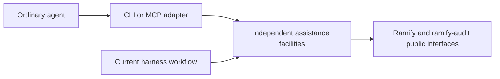

# Agent assistance: initial analysis and proposal

**Date:** 2026-10-18. **Status:** exploration proposal, not an execution plan.
**Source baseline:** `091ca382d8b514bdc6b83f0e98f00f5e395b56f1` and the current
working tree, including existing uncommitted design and analysis documents.
This is source inspection and a synthesis of retained analyses, not a new
implementation trial or independent remeasurement of their results.

## Recommendation

Start in this repository with the user's existing arrangement: Codex Astra
coordinates Sol subagents implementing a plan. Add iteration audits,
selective module focus, lightweight cross-module decisions, and explicit
sealed-file and principle handling. The [Astra coordination proposal](astra-coordination.proposal.md)
defines this first experiment and replaces the earlier context-helper-first
priority. Keep the current harness operating under its existing contracts
while extracting shared behavior incrementally.

The [capability usage analysis](capability-usage-analysis.md) inventories the
implemented facilities, what this proposal would leave unused, the resulting
tradeoffs and the smaller set of reusable behavior.

The subsequent [review and findings proposal](review-and-findings.proposal.md)
delegates complete post-iteration analysis and gating to ramify-agent, using
Pi for review, investigation and reconciliation. Astra receives a compact
candidate-specific result and judges remaining issues. This supersedes the
intermediate proposal to make Astra schedule and reconcile native reviewers.
It makes existing Pi/review/finding facilities candidates for immediate reuse
behind a smaller assessment boundary.

[Plan 47](../../plans/47-agent-assistance/main-plan.md) turns this direction
into sequential implementation iterations for Astra coordinating native Sol
workers, with Pi owning post-iteration analysis and gating.
MCP is available from the first increment. Plan registration creates an
`assisted` job in the existing plan/job system, sharing plan locations, IDs,
persistence and finding records rather than introducing a parallel registry.
Its implementation rule is thin wrappers where existing interfaces fit, or
shared extraction with both harness and assisted wrappers migrated together
where they do not. Protected-file comparison uses Git revisions and existing
candidate readers; skills and instructions are separate from runtime changes.

This proposal follows the [reasons, goals and principles](approach.principles.md).
Its first question is whether useful architectural assistance improves a
normal agent's work. A dedicated post-iteration executor is now part of the
proposal; a new full-plan orchestration engine or universal agent abstraction
is not needed.

## What the existing evidence supports

| Observation | Evidence | Implication for this exploration |
| --- | --- | --- |
| One retained run accepted one of twelve iterations and none of eleven scenarios after 4h20m. Early partial returns repeatedly incurred orientation and planning costs. | [Slow advance analysis](../../analysis/2026-10-15-slow-advance-analysis.md), an interim assessment of one run. | Test continuity in one ordinary session before adding a mandatory role lifecycle. |
| That run had no compactions or budget returns, and reported 94–98% cache reuse. Consultation policy nevertheless forced some otherwise resolvable questions through partial handback. | The same analysis, including delivered prompts and consultation examples. | Larger context or better caching alone would not address the observed coordination cost. |
| In a selected October 15–16 cohort, 256 of 788 timed changed-file checks reached their deadline; those calls consumed 21.47 minutes. | [Hook timing analysis](../../analysis/2026-10-18-ramify-hook-timing.md). These are accumulated command times across jobs. | Measure verification cost separately; changing the agent does not remove provider delays. |
| Recovery includes exact invocation and session machinery beyond the facts needed for ordinary task restart. | [Recovery complexity analysis](../../analysis/2026-10-18-task-restart-and-recovery-complexity.md), a source assessment rather than a frequency measurement. | A helper need not own the agent's conversation lifecycle to preserve useful work. |

These observations identify concrete sources of friction. They do not prove
that modularity is ineffective, that Pi or Sol is intrinsically unsuitable,
or that model training caused the behavior. Task difficulty, prompts,
provider performance and orchestration policy all remain possible factors.
Ordinary Codex is a proposed baseline whose effectiveness on these tasks
still needs observation.

## What changes in the operating model

The [earlier Codex/Claude engineering proposal](../../analysis/2026-10-16-codex-claude-engineering.proposal.md)
retains Pi architects, harness assignments, submissions and acceptance, and
changes the engineering backend. This exploration changes who conducts the
work: the ordinary host agent handles planning, implementation, coordination
and continuation, using ramify-agent where useful. That earlier proposal
remains a separate option for the current harness.

| Responsibility | Current harness | Proposed assisted work |
| --- | --- | --- |
| Plan and choose the next action | Harness lifecycle and its architect sessions | Host agent following the user's task and project instructions |
| Orient to module ownership and interfaces | Prepared role inputs and generated views | Focused facts available on demand, with source links and coverage limits |
| Coordinate a consumer/provider change | Capability task, assignments and handback lifecycle | Host agent chooses direct work or delegation and preserves the contract and integration obligation |
| Edit, inspect and continue | Equipped sessions with harness policy | Host agent's ordinary tools and continuation |
| Run checks and retain evidence | Harness invokes providers and applies its gates | ramify-agent runs post-iteration checks and Pi analyses, retaining detailed evidence |
| Decide task completion | Harness acceptance protocol and responsible architects | ramify-agent reports the candidate's gate/assessment outcome; Astra judges remaining issues and coordinates further implementation |

Assistance does not silently relax target-project rules. In particular,
toolkit importability and project acceptance requirements remain binding.
Module-specialized agents can edit other modules as their task requires.
There is no module-based write restriction, approval step or scope-expansion
protocol. Sealed-file treatment and project correctness rules remain distinct
from agent specialization. Observing edits outside the focus module is optional
and only worth adding initially if the evidence is cheaply available.

For example, a consumer needs behavior its provider does not yet expose.
The host inspects their interfaces, records the needed behavior and
compatibility constraints, and decides whether a separate provider agent
would help. It can implement both sides itself when authorized. If it
delegates, the returned result identifies the changes, checks and remaining
integration work. The host verifies the consumer with the real provider.
The helper supplies architectural context; it does not require a capability
task, frozen assignment, terminal submission or new session for each step.

## Existing facilities and the cost of reuse

Separate modules are a useful foundation, but their existence does not make
every contract suitable for external agents. The initial inventory is:

| Facility | Existing implementation | Reuse assessment |
| --- | --- | --- |
| Ownership, generated views, Git and provider observations | [evidence](../../../subs/harness/subs/evidence/README.md), particularly [views](../../../subs/harness/subs/evidence/src/views.ts) and [Ramify CLI adapter](../../../subs/harness/subs/evidence/src/ramify-cli.ts) | Best initial candidate. It owns project facts independently of run policy. Select a narrow operation; avoid importing process, daemon and Git mutation facilities wholesale. |
| Assignment and context preparation | [step authoring](../../../subs/harness/src/steps/authoring.ts), [step command](../../../subs/harness/src/steps/command.ts), [local view inputs](../../../subs/harness/src/work/view-inputs.ts) | Useful assembly logic exists. Authoring without a run still requires harness work items, assignments, policy and validation. Extract fact selection instead of making an ordinary agent fabricate these records. |
| Check execution and audit evidence | [audit](../../../subs/harness/subs/audit/README.md) | Provider integration is valuable, but the adapter also requires harness workspace recording and attempt identity. Start with the provider CLI; share a narrower adapter only when necessary. Preserve provider verdicts and provenance. |
| Finding identity and reconciliation | [check-findings](../../../subs/harness/subs/check-findings/README.md) | Pure functions with no I/O or agent dependency. Strong future candidate if repeated findings become a real burden; authorities, evidence references and persistence still require a caller. |
| Plan/principle excerpts and scenario parsing | [plan-evidence](../../../subs/harness/subs/plan-evidence/README.md), [scenarios](../../../subs/harness/subs/scenarios/README.md) | Reuse document identity, excerpts and parsing selectively. Catalog creation and harness scenario state are separate costs; Gherkin need not become an entry requirement for assistance. |
| Review preparation and assessment | [reviews](../../../subs/harness/subs/reviews/README.md), [nonfunctional](../../../subs/harness/subs/nonfunctional/README.md) | Evidence preparation can help later. Current validators and rounds encode workflow policy; wrapping them unchanged would import that policy. |
| Measurements and presentations | [kpi](../../../subs/harness/subs/kpi/README.md), [projections](../../../subs/harness/subs/projections/README.md) | Existing calculations and displays may be reusable when compatible observations exist. Their current inputs include harness records. Do not invent run/session data to populate a dashboard. |
| Mutation feedback and controlled execution | [engineer equipment](../../../subs/harness/src/work/engineer-equipment.ts), [agent port](../../../subs/harness/subs/agent/README.md) | Reuse provider checks for optional correctness hooks independently of write guards. Module-scope enforcement, submission lifecycles and session recovery remain with the controlled execution model. |

The largest initial obstacle is therefore contract coupling, not the absence
of modular code. A CLI or MCP wrapper around `RunService` would preserve that
coupling. The useful boundary accepts project facts and a concrete request
without requiring a run, role, invocation or accepted assignment.

## Coexistence and dependency boundaries

Prefer a small public operation owned by the existing harness module for the
first experiment. The root CLI calls that operation; the harness composes
its existing evidence child. Context and constraint operations need no model
session. The post-iteration assessment composes Pi and audit/review facilities
without starting the full implementation-run coordinator or its web server.

This fits the current repository rule that the harness owns public contracts
and durable state. It also avoids an external client importing a child's
internals. Update explicit Ramify exposures when implementing the operation;
do not bypass them or import generated views as source.

The intended eventual dependency shape is:

This describes responsibilities, not a decision to move every facility to a
new module now. A facility should own a useful contract and receive only its
necessary facts or ports. It must not call back into the harness scheduler.
If two consumers establish a reason to relocate it, move the implementation
and its tests once, and update exposures. A shared sibling with durable writes
would require an explicit change to the current ownership rule; the initial
experiment does not need that change.

Use existing provider commands and generated files. Preserve exact registry
pins and dependency direction. Provider improvements belong in their own
projects and reach this project through released versions.

### CLI first; MCP over the same operations when useful

A CLI operation is sufficient to test the assistance contract. Use readable
output with an optional structured representation. An eventual MCP adapter
should call the same implementation and return equivalent evidence and errors.
Transport selection should not create separate rules or state.

Context lookup needs no model call or task record. Post-iteration assessment
does run Pi and needs a durable assessment identity, completed evidence and
result retrieval. Constraint capture also persists its baseline. Each operation
identifies its project and subject; report generated-view refresh where used.
Do not introduce full native conversation replay or bind assistance to the
coordinator's session identity merely to resume observation of an assessment.

An MCP tool supplies assistance only when called. It does not establish that
all native edits were observed or checked. The experiment makes no claim of
intercepting those edits.

## Context assistance within the first experiment

The [coordinator workflow](astra-coordination.proposal.md) now defines the
initial experiment. The following context operation remains a candidate
facility within it; context lookup is not the sole measure of success.

### Establish the baseline with existing tools

Choose a bounded real change spanning a consumer and provider, with concrete
behavioral acceptance and an available verification path. Use an ordinary
Codex session with the target project's instructions, installed provider
commands and generated views. Keep a short working note covering the goal,
owners, intended contract, decisions and remaining verification when useful.
The note uses the project's existing location and format; it is not a new
tracker or required harness plan.

Suggested guidance is deliberately short: start at the consumer's need;
inspect ownership and available interfaces; preserve behavioral guarantees;
coordinate affected owners; verify the real integration. Let the host choose
its work breakdown and delegation. Do not prescribe architect roles or
require a new agent per module.

Observe where the host repeatedly assembles the same facts, overlooks an
owner, struggles to interpret a view, or loses a decision. If existing tools
already make the task straightforward, retain guidance alone until a helper
has a demonstrated job.

### Candidate facility: module context

The proposed operation takes a project and a module or path. It returns:

- The observed owner and relevant module purpose.
- Available interface/view locations and affected-consumer information where
  the provider establishes it.
- Relevant declared test locations and links to project guidance.
- Source identities, freshness information and explicit coverage limits.
- Direct locations or commands for obtaining missing detail.

These are proposed contents, not an implemented command or a guarantee that
the installed provider supplies every field. Absence stays explicit. Semantic
selection of relevant prose remains the agent's responsibility; a path-based
lookup must not claim to have understood the task.

The value is a focused, coherent answer that otherwise takes several reads
and joins. Keep it small enough to inspect; make more detail available on
demand. Reuse the evidence loader and applicable view-selection logic rather
than loading a full engineer prompt. One request must work without an
assignment, run, Pi session, review round or scenario catalog.

For a changed interface, the host can request context for both owners and
write an ordinary delegation brief containing the need, constraints, examples
and expected verification. Automate that brief only after manual usage shows
which parts recur. This provides a path toward coordination facilities
without starting with a task scheduler.

### Evaluate value before adding the next facility

Compare ordinary work with the same guidance plus the context operation.
Use matched tasks or separate checkouts from the same starting commit, retain
the same acceptance and verification requirements, and record task, model,
effort, provider versions and environment. Repeating the same task introduces
learning effects; vary ordering or use additional tasks before generalizing.
Older harness runs provide context, not a controlled benchmark.

Record a small set of observations:

| Measure | What it answers |
| --- | --- |
| Task completion and required checks | Did the intended behavior work, including real consumer/provider integration? |
| Ownership/interface review and corrective rework | Did modularity improve, and were existing guarantees preserved? |
| Human interventions and their reasons | Did assistance reduce the operator's burden? |
| Elapsed time, provider/check time and helper latency | Where did the time go? |
| Available token/cost data and explicit gaps | Did a shorter workflow merely shift cost elsewhere? |
| Useful context, missing facts and avoidable handoffs | What should the next change address? |

Use native observations when available and a short trial record for the
rest. Do not build a telemetry subsystem to measure this experiment. A tool
call count is not evidence of usefulness, and unavailable host measurements
stay unknown.

Keep the facility if repeated use saves orientation or correction work while
preserving acceptance and structural quality, without increasing human
intervention. Revise or remove it if it adds protocol work, is routinely
bypassed, or requires fabricated harness state. A single successful trial is
enough to justify another trial, not a general performance claim.

## When to remain here, extract, or separate

| Option | Benefit | Cost and decision trigger |
| --- | --- | --- |
| Keep an assistance entry point in this repository | Immediate reuse, one dependency policy and one implementation of shared rules | Recommended first. Keep helper contracts independent of run lifecycle; avoid changing unrelated harness behavior. |
| Extract demonstrated shared facilities within the repository | Clear ownership for both clients, shared tests and behavior | Do this when an actual second consumer exposes an awkward dependency. Avoid a general extraction project in advance. |
| Start a separate project with a narrow provider dependency | Independent release and experimentation cadence | Prefer this if each small experiment needs broad harness changes, incompatible contracts, or mandatory lifecycle machinery. Avoid copying the whole harness and maintaining two versions of its rules. |

After the coordinator experiment, review the actual implementation footprint:
what existing callers changed, what new lifecycle types were required, and
whether an ordinary invocation remains independent. If coexistence costs more
than the useful facility, a separate small project is preferable to forcing
the fit. A shared package can follow proven reuse; its publication and
versioning are additional work, not prerequisites for learning.

The next possible facilities are change-impact context, concise contract and
handoff preparation, evidence retrieval, and finding reconciliation. Choose
among them from observed friction. The long-term aim is a useful collection
of facilities composed by either workflow, with the current harness remaining
one consumer. This document proposes that direction; implementation, live
trials and any harness migration remain subsequent work.
