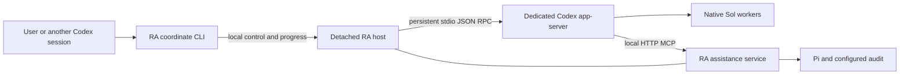

# Persistent Codex coordinator through app-server

**Date:** 2026-10-19. **Status:** proposed design; runtime implementation and
live disconnect qualification remain future work.

The [assisted implementation plan](../../../plans/codex-coordinator-host/plan.md)
defines delivery iterations and acceptance after the harness decomposition lands.

Let ramify-agent launch an assisted Codex coordinator in the devcontainer and
keep it running when the user's terminal, IDE or network connection disappears.
Start with a detached RA host, a dedicated Codex app-server process and a small
CLI control surface. Add monitoring, compaction and notifications later through
the same host and provider adapter.

The persistence guarantee covers a client disconnect while the container and
its connection to the model provider remain available. A host crash, container
restart or provider outage is a distinct interruption. Retained conversation
history helps continuation but does not preserve running processes.

This follows the [assistance direction](approach.principles.md),
[harness principles](../../harness.principles.md) and adopted
[recovery principles](../../harness-recovery.principles.md). Astra still chooses
implementation work and delegates to native Sol workers. RA still assesses
committed candidates through the [existing service](service.spec.md). Launching
Codex does not introduce the autonomous harness's task graph or acceptance rules.

## First version

Support one active coordinator per target checkout, with:

- Detached launch for a named plan, or continuation of an existing assisted job.
- Status, readable progress, sending a follow-up and answering pending requests.
- Explicit interruption and host shutdown, with their effects reported.
- Reconnection to the live host without restarting Codex or an assessment.
- Manual continuation after a process interruption, reusing a thread when useful.

Use the existing coordinator and worker skills. Preserve the user's effective
models, tools, permissions and instructions; explicitly select the configured
Astra coordinator and Sol workers. Do not silently substitute another model or
replace the user's configuration with a reduced automation profile.

Automatic continuation after a finished turn, watchdog recovery, compaction policy,
alerts, browser UI and remote hosting are later features. A finished Codex turn
leaves the host available for another message. It does not establish plan completion.

## Processes and connections



The host and assistance service live in one RA process. The host owns the Codex
child, continuously drains its output and keeps its input open even with zero
connected CLI observers. The user's connection is only to the host. Losing it
does not cancel a turn, close MCP or stop an assessment.

Use a dedicated `codex app-server --listen stdio://` child initially. The host
detaches from its launching terminal with independent standard streams and file
diagnostics. It never inherits an IDE-owned pipe for its lifetime. The child
remains attached to the host's pipes. This avoids requiring tmux, systemd, a
shared Codex daemon or a direct remote connection to Codex.

Launching through another Codex session's shell tool is a separate supported-path
qualification. Detaching standard streams and creating a new process session do
not remove an inherited sandbox or guarantee survival of the tool runner's cleanup.
Verify agent launch in each supported execution environment, including after the
launching tool returns and its session closes. If that environment cannot keep a
permitted detached host alive, report the limitation and use a terminal-launched
host; the agent can still control it. Do not bypass the launching session's policy
or claim arbitrary sandboxed launch support from terminal-only evidence.

Codex documents a bidirectional JSON-RPC app-server interface, stdio transport,
thread start/resume, turn start/steer/interrupt and streamed events. Its schema
generator produces bindings for the installed version. These are the provider
operations used by this proposal, not existing RA commands.
[Official app-server documentation](https://learn.chatgpt.com/docs/app-server)

The checked CLI is `0.161.0`. Record the tested version and required methods in
the adapter's qualification evidence. App-server is experimental: validate the
actual installed protocol and required behavior before implementation release.
Do not make all version changes errors; report a concrete missing operation or
incompatible shape. Never upgrade or restart the user's shared daemon implicitly.

## One owner for assisted state

Reuse `AssistanceService`, its assessor, ledger, command receipts and
`createAssistanceMcpServer`. The host opens one service, which holds the existing
project lock. Add an official SDK Streamable HTTP transport for that same service
instead of launching the current standalone stdio owner for each Codex client.
Each MCP connection has its own transport/server instance and shares the service.
Closing a connection releases transport resources, not the service.

Serve MCP and the small control API on a single loopback listener with an
OS-selected port. Authenticate local requests with a random bearer credential
stored in a user-private runtime file; validate browser origins and host headers.
There is no public listener or port-forwarding requirement. A future remote UI
must supply its own authenticated access boundary.

The installed `@modelcontextprotocol/server` package exports
`WebStandardStreamableHTTPServerTransport`; adapt it to the existing Node/Express
stack using the package surface. Keep MCP framing and protocol handling in the
SDK. The installed package supplies a Fetch-standard handler, not a ready-made
Express request adapter. The first slice includes converting Node requests into
`Request` objects and streaming `Response` headers and bodies back to Node,
including SSE flushing, backpressure and disconnect/abort propagation. Avoid
buffering the response or consuming the request body twice through middleware.
Configure applicable HTTP/socket deadlines to allow the 15-minute assessment
wait plus transport margin. JSON responses are also possible, but do not remove
the need to handle streaming responses correctly. Streamable HTTP availability
is not evidence that these bridge semantics have already been qualified here.

Configure this Codex process's RA MCP entry with the local URL, a credential
environment variable, required startup and a tool deadline above RA's 15-minute
assessment wait. Codex supports these HTTP MCP configuration fields.
[Official configuration reference](https://learn.chatgpt.com/docs/config-file/config-reference)

Use process launch-time `-c` overrides to disable the existing global stdio entry
by its exact configured name and add a separate, collision-free HTTP entry. For
example, when the old name is `ramify-agent`, the relevant override values are:

```toml
mcp_servers.ramify-agent.enabled = false
mcp_servers.ramify_host_abc123 = { url = "http://127.0.0.1:PORT/mcp", bearer_token_env_var = "RAMIFY_COORDINATOR_MCP_TOKEN", required = true, tool_timeout_sec = 930 }
```

These are per-process override values passed as argument-vector elements, not
edits to `$CODEX_HOME/config.toml`. Write a hyphenated name unquoted in the dotted
key: the checked CLI applies `mcp_servers.ramify-agent.enabled=false` and rejects
the quoted segment form with an invalid-transport error, as `codex mcp list` with
each override shows. Never add `url` to the old table while its
`command` remains. The new name must not collide with an effective global,
profile or project entry. Launch settings identify the old entry names explicitly
(repeatable `--replace-mcp <name>`); do not assume a universal RA server name or
disable unrelated servers by a name heuristic. Disable every configured standalone
RA entry for this target. Verify the resulting enabled server/tool set before the
first implementation turn, including native worker inheritance.

On host restart, reapply the disabled names and current HTTP endpoint/credential
configuration to the resumed thread; retained thread settings must not revive an
old stdio entry or stale endpoint. Preserve unrelated MCP entries and the user's
global file. Native workers need no separate assessment ownership; inherited HTTP
connections share the one service. Credential values stay out of prompts,
receipts and progress logs.

The existing standalone `ramify-agent mcp` workflow remains supported. V1 does
not run the new host beside another live `serve` or standalone MCP owner for the
same checkout. Report the existing owner and leave it running. Future composition
with the web server can share this same service without changing the owner rule.

## Launch and registration

The proposed entry point is:

```text
ramify-agent coordinate start --project <root> --plan <id>
ramify-agent coordinate start --project <root> --plan <id> --job <existing-job>
```

The launcher resolves the checkout, validates the plan and runtime configuration,
then starts the detached host. The host acquires ownership before launching Codex
or creating an assisted execution. Concurrent launchers therefore cannot both
start coordinators. Repeating start for the same live target returns its identity;
a different active target is reported without replacement.

The host discovers existing executions through the service. For a new execution,
it registers the plan through the ordinary `planStart` operation with a retained
command ID. An explicit job selects continuation. When multiple existing jobs
make the intended execution ambiguous, return their identities for selection;
do not silently capture a fresh baseline. Existing protection and baseline-gap
rules still apply. Registration is not a source commit or implementation approval.

Before spawning Codex, the host installs its MCP/control handlers, binds the
loopback listener, awaits successful listening and establishes endpoint readiness.
Only then can it construct the URL overrides and launch the provider. Binding
failure ends startup without spawning Codex. A required MCP server's startup
timeout is a failure detector, not a substitute for this ordering; thread start
and resume must find the endpoint already reachable.

Next the host starts Codex, completes initialization and calls `thread/start`
with `ephemeral: false`. It never creates ephemeral coordinator threads, including
fresh-thread fallbacks during resume. Verify the returned persistence flag and
retain the thread ID before submitting implementation input. Use the configured
persistent Codex history location. Persistence enables later thread reuse; it does
not guarantee every in-flight operation survives a crash.

The host verifies the intended model, native worker support and required RA MCP
tools. Prepare the initial message with the target root, coordinator skill path,
plan/job IDs and instruction to continue the captured execution. The coordinator
skill must recognize this supplied registration and read `job_detail` rather than
register again. All later iteration and final assessment calls remain the
coordinator's responsibility.

Return a coordinator ID, plan/job IDs, thread ID and observed state once the
initial turn has been acknowledged. If startup fails, retain the actual phase and
reason; a registered job with no launched turn remains available for continuation.
A CLI timeout reports an uncertain launch and gives the status command. It does
not stop the host or submit another initial prompt.

Readiness checks establish equipment, not successful implementation. Missing
credentials or skills are reported without broadening permissions. The user can
configure unattended execution using their existing permission policy; the host
does not convert a request for approval into automatic acceptance.

## Interaction from a person or another Codex session

All commands below are proposed. They use harness-owned request/result contracts
and offer JSON output for agents. `<id>` is the returned coordinator ID; the
project argument locates the host.

| Command after `coordinate` | Behavior |
| --- | --- |
| `status --project <root> [--id <id>] --json` | Live host/provider state, plan/job/thread IDs, pending requests and last error. If unreachable, report last observed state as stale. |
| `watch --project <root> --id <id> [--after <cursor>]` | Read retained progress and follow new output. Disconnect or Ctrl-C stops observation only. |
| `send --project <root> --id <id> --message-file <path> --command-id <id>` | Start a turn when idle. Refuse a busy turn with its identity; do not silently queue or interrupt. |
| `respond --project <root> --id <id> --request <id> --response-file <path> --command-id <id>` | Answer a specific pending question or approval with a validated response. |
| `interrupt --project <root> --id <id>` | Request interruption of the current coordinator turn and report observed settlement. |
| `stop --project <root> --id <id>` | Shut down this host and its owned execution; report interrupted assessments and unresolved child cleanup. |
| `resume --project <root> --id <id>` | Continue authorized unfinished work after the old owner has settled, using the same job and preferably its retained thread. |

`watch` supplies the reconnect experience in v1. It is not an embedded Codex TUI.
Another Codex session can call these commands through its shell tools; it does not
need screen scraping or native parent/subagent membership. Interactive steering
of a busy turn can later be an explicit `send --steer` option.

The adapter must handle server-initiated requests, including command/file approval
and user input. Requests remain visible while the user is disconnected; only an
actual authorized response answers them. Bind request identity to the host
generation and Codex thread/turn so stale responses cannot answer new requests.
Concurrent responders cannot both settle the same request. Unsupported request
types become visible errors, never silently approved or ignored.

A plain agent message asking a question may end its turn without a structured
request. Preserve that message and show the thread as idle; `send` continues the
conversation. Do not classify every idle thread as waiting for approval.

Interrupting the coordinator turn is distinct from stopping its workers or an
already submitted assessment. Report the observed child and assessment states;
do not claim all writers stopped from a parent turn event. Explicit host stop
settles owned workers/commands and closes the assistance service, retaining its
ordinary interrupted-assessment records. Process cleanup behavior is a required
native qualification case before stop or replacement can be considered reliable.

## Small retained record and honest status

Keep coordinator records under the target's generated, ignored
`plans/.harness/coordinators/<id>/` directory. The harness is their only writer.
Reuse existing ledger/atomic-write helpers for durable admission and command
receipts; do not introduce another transaction framework.

Retain only what reconnect and ordinary continuation need:

- Target root, plan/job IDs, coordinator ID, launch time and initial task reference.
- Codex thread ID, selected models and runtime version; ordinary configuration
  references rather than copied credentials or an entire environment snapshot.
- Current host generation, process identities, active turn, pending requests and
  observed state, with observation time and error when present.
- Command IDs and acknowledgements, plus a bounded progress log with cursors.

Codex owns its conversation history. RA owns plan state, assessment evidence and
control receipts. The progress log supports reconnect; it is not another complete
conversation database. Bound its size and rotate it. A cursor outside retained
history returns an explicit gap and current snapshot. Slow watchers cannot block
the provider reader or consume unbounded memory. Avoid recording hidden reasoning
or copying full tool payloads into the operator log.

Expose independent host, turn and assessment state. A live host can have an idle
thread; a failed turn can leave an assessment running. A final response or zero
process exit is not a clear final-plan assessment. Read acceptance from the
existing service and bind it to its candidate.

Within a running host, command IDs prevent repeated delivery after a lost CLI
reply. Across a host crash, an accepted provider mutation whose acknowledgement
was not retained can be uncertain. Mark that uncertainty, inspect retained thread
state where possible, and never promise exactly-once provider execution or blindly
resend an approval/message. Recovery otherwise follows ordinary task inspection.

## Failure and continuation

| Event | Required behavior |
| --- | --- |
| User network, terminal or IDE disconnect | Host, Codex, MCP and assessment keep running. Reconnect observes the same identities. |
| Last watcher leaves | Keep the provider connection open; no execution lifecycle change. |
| User response is required | Retain the pending request and wait under existing policy. |
| Codex turn fails or finishes | Record its outcome, retain partial work and keep controls available. No automatic new turn in v1. |
| Codex process exits | Record provider failure. Keep the host and assessment service available for inspection and explicit continuation. |
| Host crashes or container restarts | Report loss of live ownership. Reconcile surviving owned processes before starting replacement writers. |
| Provider connectivity fails | Surface Codex's actual outcome; client-disconnect resilience does not imply provider-network resilience. |

V1 has no automatic restart loop. `resume` performs ordinary service recovery,
retains the original job and baseline, and gives the coordinator current repository
state and pending work. Resume the recorded thread when usable; a missing thread
can use a fresh coordinator with the same task and authority. Do not reset files,
discard partial edits or require conversation reconstruction. Interrupted
assessments retain their existing explicit resume behavior.

The host records process start identity as well as PID. If an old process or
worker may still write, establish settlement before replacement. A socket failure
or stale-looking timestamp alone never authorizes killing another session. The
host owns only its dedicated app-server, not unrelated Codex sessions. This design
does not assume that closing app-server stdin always stops all descendants.

The devcontainer already keeps running on editor close through
[`shutdownAction: "none"`](../../../.devcontainer/devcontainer.json). Persist
Codex history and RA records on the existing mounted storage. Reboot survival
means retained state plus continuation, not uninterrupted execution.

## Extension points without a supervisor framework

Keep three responsibilities separate within the implementation: coordinator
lifecycle/control, Codex protocol adaptation, and event projection for clients.
Use a small typed adapter covering only the operations v1 needs. Do not build a
generic multi-provider orchestration layer or plugin scheduler in anticipation.

| Later feature | Additive change |
| --- | --- |
| User alerts | Consume pending-request, turn-failure and host-exit observations. An external watcher is needed to detect death of the host itself. |
| Session health checks | Observe existing status and activity, then investigate concrete evidence. Long tool calls and assessment waits are not proof of a stall. |
| Manual or automatic compaction | Add an adapter operation and policy using provider context observations; serialize it with conversation mutations and preserve pending requests. |
| Active-turn steering | Add an explicit control mapped to the provider's steer operation with expected turn identity. |
| Browser UI or MCP controls for other agents | Consume the same control contracts and event projection. Keep execution independent of client lifetime. |
| Automatic continuation | Add explicit policy for idle/error outcomes and user stops, retaining ordinary job acceptance and recovery. |

App-server exposes status and token-usage notifications and a manual compaction
operation. Those provide the technical attachment points; compaction thresholds,
health judgments and alert destinations are RA policies to design when needed.
[Official app-server documentation](https://learn.chatgpt.com/docs/app-server)

Leave Codex's normal context management enabled. A future RA compaction policy
should complement observed provider behavior, not force periodic compaction or
treat context pressure as plan failure.

## Implementation placement and qualification

The root CLI parses commands, launches the detached entry point and presents
results. Harness code owns lifecycle, control contracts and durable records.
Reuse the assistance runtime and MCP tool registration. The Codex adapter owns
protocol initialization, request correlation, event decoding and pending provider
requests. Web code, if added later, only projects results and forwards commands.

This feature lands after the
[harness decomposition](../harness-decomposition.proposal.md). Target the resulting
owners rather than the current assistance directory:

- The `assistance` child owns coordinator launch/continuation policy, plan/job
  association, control behavior, progress projection and coordinator records,
  alongside its existing assessment service and MCP adapter.
- The `agent` child exposes a Codex provider adapter, implemented in an `agent/codex`
  child, for app-server process/protocol interaction. It receives prepared inputs
  and reports provider events; it does not interpret plans or decide acceptance.
- The harness parent composes these services, project ownership and the listener,
  and exposes the supported facade consumed by the root CLI and a future web UI.
- Reuse `task-execution` mechanics where their contracts fit, particularly
  cancellation/settlement and execution observations. Do not force the interactive
  Codex coordinator through a Pi-specific task/submission loop or reimplement
  Codex's native worker scheduler.
- Use existing ledger/persistence facilities for RA-owned records. `session-store`
  continues serving RA-managed sessions; Codex retains its own conversation history.

Exact exposure declarations follow the completed decomposition's APIs. Keep the
assistance additions together initially; no separate supervisor module is needed.
Reuse existing assessment behavior rather than copying it into the new host.

Implement the smallest vertical slice first: detached host, one provider thread,
shared assessment service with the Node/Fetch streaming bridge, launch-time MCP
configuration, CLI start/status/watch/send/respond/stop and the
[coordinator skill revision](../../../.agents/skills/ramify-agent-coordinate/SKILL.md),
then ordinary resume. The skill revision handles supplied plan/job IDs by verifying
them with `job_detail` and continuing that registration. A mismatch is an error,
not a reason to call `plan_start`. Preserve the existing discovery/registration
workflow when no registration is supplied. Deliver the matching usage guidance
with this slice and qualify both entry paths; prompt text alone is not a substitute
for updating the skill. Qualify the slice before adding automated policies. No
implementation run or plan registration is authorized merely by this design document.

Follow the [testing contract](../../testing.spec.md). Script process, Codex, Git,
audit and provider answers in ordinary tests. Cover launch races, replayed command
IDs, lost replies, stale responses, slow observers, provider errors and independent
turn/assessment state. Test real process claims only through exact reviewed native
boundary entries, and retain live-provider evidence separately.

Required qualification includes:

1. Launch through a terminal, disconnect that terminal and every observer, then
   verify the host still owns the same thread and continues useful work.
2. Separately launch through a Codex shell tool in the supported devcontainer
   execution mode. Let the tool finish, close the launching session and disconnect
   the client. Verify host/provider/assessment survival and effective permissions;
   retain the tested sandbox/process-cleanup conditions with the evidence.
3. Disconnect during a native Sol assignment and during a real RA assessment.
   Reconnect to the same job, iteration and assessment IDs without duplicate work.
4. Ask for user input, disconnect, reconnect and answer the exact pending request.
   Verify unsupported and stale responses cannot silently continue execution.
5. Retry start and send after lost replies; show one admitted coordinator and one
   delivered message in the live-host case, and honest uncertainty after a crash.
6. Verify multiple MCP connections share one owner, client closure does not close
   the service, and an existing standalone owner is left intact.
7. Start from a global stdio RA entry and unrelated MCP entries. Verify the old
   entry is disabled, the new entry is HTTP-only, unrelated entries and the global
   file are unchanged, and resume/worker inheritance use the intended service.
8. Hold listener readiness and verify Codex is not spawned early; fail binding
   and verify no provider is launched. Verify `ephemeral: false` on every new
   coordinator thread and read/resume its persisted history after process restart.
9. Exercise the Node/Fetch bridge with real local HTTP/SSE streaming, response
   headers, backpressure, client abort and a long assessment observation. Verify
   abort releases observation resources without cancelling assessment work. Use
   controlled timing in ordinary tests and a native timeout witness for the actual
   long-lived connection rather than making every test wait 15 minutes.
10. Exercise interrupt, stop, provider exit and host crash with active child work.
    Establish actual process settlement before claiming safe replacement.
11. Continue an interrupted job with a retained thread and with unavailable thread
    history. Preserve partial source and the original assessment obligations.
12. Exercise the revised coordinator skill with a host-supplied registration and
    the ordinary unsupplied path. Confirm the supplied job is inspected and reused
    without a second registration or baseline, while ordinary discovery still works.

Run the repository's required structural checks and default configured audit on
the committed implementation. A scripted protocol pass does not establish live
disconnect resilience, worker availability or effective compaction behavior.
