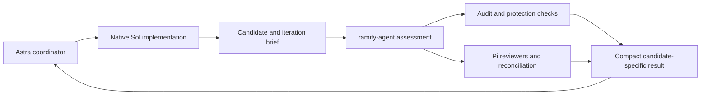

# Post-iteration assessment with Pi

**Date:** 2026-10-18. **Status:** proposal for the assisted workflow; no
review service, skill or tracker integration is implemented here.

## Recommendation

Delegate the whole post-iteration assessment to ramify-agent: candidate
inspection, protected-file comparison, audit execution, independent code/scope/
design review, coverage recording, finding reconciliation and the resulting
gate decision. Use Pi for all agentic analyses in this facility. Astra
coordinates native Sol implementation agents and intervenes after assessment
only for issues that still need its judgment or another implementation action.

This replaces the earlier proposal in which Astra launched reviewers, read
their reports and reconciled findings itself. That arrangement would consume
the long-lived coordinator's context for routine assessment. The intended
benefit here is less evidence and procedural work in Astra's context; actual
performance and compaction effects need measurement.

Keep detailed evidence and the active finding record with ramify-agent. Return
a compact result with links for optional inspection. Use Beads only for
selected deferred work worth taking up independently of this plan.

This extends the [Astra coordination proposal](astra-coordination.proposal.md)
and revises the initial choice to omit automatic review from the
[capability inventory](capability-usage-analysis.md). The goal is to catch
meaningful defects and omissions without creating an endless repair process
or a low-value backlog. Module-specialized engineers remain free to edit other
modules; review introduces no module-based write restriction.

The sequential [implementation plan](../../plans/47-agent-assistance/main-plan.md)
uses MCP from the first increment, with basic plan registration linking later
assessments and findings. It then delivers follow-up assessment, coordination
skills and a real MCP pilot. CLI wrappers are optional.
It reuses existing assessment facilities through thin wrappers, extracting
common behavior for both execution kinds where necessary. Sealed-file changes
are found through Git comparison; RA supplies selection and exception policy.

## Responsibility boundary

Astra supplies the outcome and acceptance references once, then submits the
finished candidate. ramify-agent constructs the review evidence, chooses and
executes the review work, investigates worthwhile uncertainties, settles
ordinary observations within delegated authority, and assembles the result.
Semantic decisions use Pi; deterministic code runs checks, validates records
and preserves source identity. Neither regexes nor severity labels decide
whether an implementation satisfies a principle.

The first version assesses source without modifying it. This is a proposed
boundary for the analysis/gating facility: real code repairs stay with Astra's
existing Sol workers. The service returns a concise repair brief for confirmed
problems instead of every raw reviewer suggestion. It may retry a transient
analysis failure or gather further evidence itself. It cannot weaken an
acceptance requirement, authorize a protected edit or waive a required failing
check merely to produce a clear result.

This delegates analysis and its housekeeping, not the entire implementation
loop. Automatic repair could be considered separately after experience; it
is not a hidden prerequisite or a second writer in this first version.

### One assessment request

The request names the project, base and candidate commits, iteration brief,
plan/acceptance references, protection baseline and relevant prior decisions.
The brief includes the intended outcome and any material decision not already
in those sources. It is not the complete Astra conversation or every worker
transcript, and need not use a harness work-item or assignment schema.

ramify-agent reads the named sources and builds bounded packets for Pi. A
reviewer can inspect further evidence when needed. Separate reviewer sessions
carry focused questions; a reconciliation session receives their reports and
can investigate supporting evidence. It need not inherit their transcripts.
Successive iterations reuse durable decisions where relevant, not an
ever-growing analysis conversation.

The audit must answer the submitted candidate, not whatever happens to be
HEAD later. Resolve it in an appropriate candidate checkout and preserve the
provider's actual source identity and result. Source readers use immutable Git
objects or a stable snapshot. Candidate changes require another assessment;
they do not retarget an in-flight review.

### Compact result and selective escalation

Return the candidate identity, audit and protection outcomes, review coverage,
material unresolved findings and a recommended next action, with evidence
references. Keep these components distinct even when supplying an overall
status:

| Overall status | Meaning for Astra |
| --- | --- |
| **Clear** | Required checks passed, required assessment completed, and no issue needs Astra's action under the declared policy. Continue without rereading settled reports. This is not a proof of perfect semantic correctness. |
| **Action required** | Assessment established a repair need, a material unresolved design choice or a protected commitment conflict. Return only its consequence, evidence, proposed action and why it remains unsettled. |
| **Incomplete** | A required check or review could not establish its result. Name the missing evidence and recommended recovery; do not call this a clean candidate or invent a defect. |

If a review is explicitly best-effort, an authorized coverage gap can coexist
with otherwise clear checks, but the gap remains visible. A required review
cannot disappear behind that policy. If both defects and gaps exist, return
both even though the summary selects one next action. Astra receives grouped
issues, not a severity-ranked dump of all observations.

Pi may dismiss unsupported or duplicate observations and accept minor tradeoffs
within the supplied policy. A semantic issue becomes resolved through evidence
and reasoned assessment, not just because the reconciler disagrees. Genuine
disagreement affecting acceptance, user-controlled changes and important
remaining risk reach Astra. Required failures cannot be downgraded by triage.

The normal user-facing output contains no reviewer transcripts, full audit
logs or repeated settled findings. Detailed artifacts remain retrievable.
Long-running requests return an assessment handle and a quiet status/result
interface so transport timeouts do not force a restart or stream all activity
into Astra's context. Resuming observation returns the existing assessment;
it does not launch another set of reviews. Cancellation leaves an explicit
incomplete result and stops the facility's own work.

## What is worth preserving

The current implementation provides several distinct benefits:

| Goal | Current mechanism | Proposed preservation |
| --- | --- | --- |
| A second perspective catches mistakes the author misses. | Separate code/scope/design sessions and a review queue. | Pi reviewers independent of the implementing worker, scheduled by ramify-agent. |
| Reviews concern a definite candidate. | Immutable snapshots, captured guidance and bounded patches. | Base/candidate identities and a review packet with the applicable requirements, principles and audit evidence. |
| Silence cannot masquerade as completed review. | Every changed path is reported inspected or missing; preparation and tools supply evidence. | Explicit selected coverage, reported inspection, missing work and unavailable attempts. |
| Meaningful concerns survive a repair or a handoff. | CheckFinding identities, relations and reconciliation. | A small active finding set with evidence, decisions and verification, linked to original reports. |
| Fixes are checked and accepted risks are not rediscovered endlessly. | Reassessment, factual witnesses and settled dispositions. | Targeted follow-up, retained reasons and reopening only when new evidence changes the assessment. |
| Attention goes to useful work. | Risk, credibility and cost principles. | Pi reconciliation evaluates expected harm, evidence and cost; Astra receives only remaining actions or decisions. |

These mechanisms can be separated. The current
[review preparation](../../../subs/harness/subs/reviews/src/preparation.ts)
assembles candidate evidence, while the
[scheduler](../../../subs/harness/src/reviews/scheduler.ts) owns queue and
attempt policy. The [validator](../../../subs/harness/subs/reviews/src/submission.ts)
ties claimed inspection to delivered patches or snapshot reads. We should
reuse useful evidence behavior without importing its role/session protocol.

The [CheckFinding principles](../../check-findings.principles.md) already say
that persistent findings are for issues that need tracking, not every reviewer
note, and that human attention and investigation have a cost. The current
[specification](../../check-findings.spec.md) retains distinct factual and
subjective settlement and calls for reconsidering repeated corrections.
Those goals matter more here than reproducing its complete event model.

## Review scheduling within the assessment facility

### Every substantive iteration gets an independent review

At the candidate boundary, ramify-agent prepares a review packet and starts
a Pi reviewer independent of the implementing worker. The default is one
combined code and scope review, explicitly answering both questions:

- **Code:** does the behavior work, including error cases, compatibility,
  integration and meaningful tests?
- **Scope:** does the result meet the iteration's requirements, without
  omitted behavior, weakened acceptance or unjustified unrelated work?

Scope refers to the intended outcome. Editing another module is not a scope
finding. A defect's location does not limit where a worker can repair it.
The reviewer inspects additional files and consumers wherever needed.

The facility's Pi assessment can split code and scope into separate reviews
when the knowledge or change size warrants it. Tiny corrections receive a focused follow-up
to the existing review rather than restarting all review roles.

### Design review has explicit triggers

Schedule a design/principles review when an iteration changes public behavior
or interfaces, module responsibilities, important dependency relationships,
cross-module protocols, or a design governed by applicable principles. Also
schedule it when the iteration brief or a reviewer identifies a substantive design
uncertainty. These are semantic judgments; changed paths can provide clues,
but filenames and line counts alone do not decide them.

The design question may be included in the same reviewer assignment for a
small change. Use a separate reviewer where another perspective justifies its
cost. Relevant adopted principles are provided with their source identity and
status. A proposed principle is not silently upgraded to an approved requirement.

At plan completion, include a cumulative acceptance/integration review against
the original plan and relevant principles. It looks for gaps between iterations
and behavior that no local diff demonstrated. Earlier candidate-bound evidence
can inform it; it need not repeat all line-by-line review.

### Automatic within one delegated operation

The coordinator skill submits the candidate and consumes the compact result.
ramify-agent owns the internal schedule, Pi invocations, bounded operational
retries, review evidence and reconciliation. It reports unfinished required
work instead of silently omitting it. This is an executing facility, not just
instructions asking Astra to perform every step. It does not need the full
plan architect, module-assignment or capability-task lifecycle.

Audit and review can run concurrently against the same stable candidate;
reviewers receive audit results when available. Slot pressure can serialize
reviews without dropping them. Astra may prepare later work while readers
inspect the candidate, but treats material findings before accepting dependent
work. Review evidence comes from fixed Git objects or an isolated snapshot,
not a concurrently changing working tree.

After repairs, verify the new candidate with applicable audit evidence and
review the repair and affected behavior. Old coverage remains evidence about
the old candidate. Pi assessment identifies what carries forward and what requires
another look; identical file bytes alone do not prove unchanged behavior when
dependencies changed. Unfinished or failed reviews remain visible as gaps.

## Honest inspection coverage without intercepting every read

A review record should identify the base and candidate, review questions,
reviewer, relevant requirement/principle versions and the selected files or
behaviors. Preserve these distinctions:

| Evidence | What it establishes |
| --- | --- |
| Complete patch or source supplied in the packet | Material was available to the reviewer; it does not prove understanding. |
| Reviewer reports inspecting a file or behavior | A self-reported assessment, tied to the candidate. |
| A snapshot read/diff operation records returned bytes | Observed access to that evidence, where such a tool is used. |
| Selected material was omitted or inaccessible | A coverage gap with a reason; not a clean result. |
| Material was intentionally outside this review | The review's stated selection, not a claim about the whole change. |

The existing validator usefully prevents claims about undelivered/unread
evidence, but requiring all native reads to go through its special tools
would add coupling. Start with prepared packets, reviewer-declared inspection
and explicit gaps. Retain optional observed access if snapshot CLI/MCP tools
provide it cheaply. Do not relabel declared inspection as verified access.

Every selected item must have an answer or a gap, including requirements
whose implementation is absent and therefore has no changed file. Validate
record shape, candidate references and omissions mechanically. Semantic
coverage and whether the reviewer actually understood the code remain judgments.
Malformed output can be corrected in the same ordinary session; a timeout or
missing report cannot become “no findings.” Reviewers need not find an issue
to produce a useful result.

## Findings: separate observations from commitments to act

A reviewer returns concrete concerns: what may fail, when, the consequence,
supporting code or requirement evidence, and uncertainty. It should omit
stylistic preferences and speculative general improvements unless they have
a material consequence or an applicable requirement. Do not impose a quota
that encourages invented findings or conceals additional serious defects.

The complete report is retained as evidence. Its observations do not each
become an open task. Pi reconciliation assesses them together, merging concerns about
the same behavior and preserving any material disagreement between reviewers.
A filename match alone is not enough to merge issues.

| Assessment decision | What happens |
| --- | --- |
| **Repair** | Add to active findings and return a consolidated repair brief to Astra, with the evidence needed to verify it. |
| **Investigate** | Seek a focused piece of evidence where plausible harm warrants the effort; uncertainty alone neither dismisses nor proves the concern. |
| **Dismiss** | Record that the claim is wrong, duplicated or outside the applicable requirement, with a brief reason. It creates no backlog. |
| **Accept the tradeoff** | Record the understood residual risk and why further work is not worthwhile, within existing authority. It creates no backlog. |
| **Defer worthwhile work** | Preserve a concrete independently useful outcome and recommend promotion to the configured tracker when authorized. Deferral is not a fix. |
| **Unresolved** | Preserve the issue or coverage gap and its consequence when a responsible decision cannot yet be made. It is not silently filed away as low priority. |

These are decisions in a small review record, not six queues or six new agent
roles. Simple concerns can be settled inline or together when one rationale
applies. Only issues needing repair, investigation, later verification or an
unresolved decision enter the active set. No new active record is needed for
every compiler diagnostic already retained in an audit report.

Risk and credibility guide attention; neither a reviewer severity label nor
an exact numeric score dictates the outcome. A cheap, valid low-impact fix
can be worth doing immediately. A plausible high-impact concern can justify
investigation despite weak initial evidence. Author assertions and a file's
suffix do not establish review provenance.

### Repairs and stopping

A worker's “fixed” message records a claim. Closure needs evidence: a factual
failure needs the applicable check result; a semantic concern needs assessment
against the repaired candidate, normally by the original reviewer for a
material issue through a fresh assessment of the repaired candidate. Required audit/acceptance failures cannot be waived or moved
to backlog to make the iteration pass. Changes to protected requirements
retain their governing authority.

The normal path is assessment, a concise repair result where needed, native
Sol corrections and focused reassessment. If the same concern survives another
pass, Pi investigates and explains why before returning it. Astra reconsiders
the approach using that condensed evidence instead of replaying the reviews.
There is no arbitrary round count that turns unresolved work into success.
Stop discretionary polishing when another pass offers little expected value;
continue needed correctness work or report a real unresolved blocker.

Retain the reason for dismissed or accepted concerns so later reviewers do
not restart the same argument. Reopen when evidence, behavior or the governing
requirement materially changes, with that change stated explicitly. Mere
repetition or a higher severity label does not establish new evidence.
Settled concerns remain inspectable in reports but leave the active attention
set. They do not need repeated user notifications.

## Beads: useful for selected deferred work

Beads can store follow-up issues, but storage does not decide which observations
deserve future attention, whether a repair is verified, or which candidate a
review covered. Changing trackers alone would not solve accumulation.

| Option | Assessment |
| --- | --- |
| Put every finding into Beads | Simple unified issue access, but turns reviewer output into backlog and needs extra conventions for review coverage, verification and dispositions. Not recommended. |
| Keep all review and deferred work in local review records | Small initial dependency surface; long-lived deferred work may become hard to discover across plans. Adequate if no tracker is configured. |
| Keep active reviews local; promote selected deferred work to Beads | Recommended. Candidate evidence stays with the plan; the tracker contains work intentionally selected for a future outcome. |

Promotion should answer a few practical questions: is the problem supported,
does it have a meaningful consequence, why is it outside this plan, and what
future event or priority would make it worth doing? Search for an existing
issue before creating one. Link the issue to the originating evidence and
decision; keep that link in the review record. Do not create a standing
“maybe improve this” ticket merely because a reviewer suggested it.

The promotion rule is not “never file low severity.” A small recurring cost
can justify work. Conversely an impressive severity label with no credible
failure path may justify investigation rather than a permanent issue.
Before resuming a deferred issue, confirm it still applies. If later judged
unnecessary, close it with that reason rather than calling it fixed. No
automatic age-based deletion or recurring backlog-cleanup service is proposed.

Beads records the deferred issue's lifecycle; the review record retains the
original decision and evidence link. Do not maintain two synchronized active
task states. A later issue closure does not rewrite an old candidate's review.
Without a configured or authorized tracker, a worthwhile deferred concern
remains visible in the plan handoff; do not silently drop it or create an
unrelated tracker workspace.

### Current repository boundary

The local [Beads skill](../../../.agents/skills/beads/SKILL.md) covers deferred
issues in ramify-agent itself, not active plan execution or arbitrary target
projects. Configured harness tracker sessions currently update related existing
issues; they do not create review-derived issues. Using Beads for all active
review findings would therefore require changing policy as well as code.

The recommended split preserves the local distinction. Creating deferred
issues for another target would need that target's authorized tracker workflow
and explicit workspace. An eventual opt-in promotion adapter must respect
those boundaries; this analysis authorizes no tracker writes or synchronization.
Beads is optional and never determines candidate acceptance.

## Implementation shape

Expose one assessment operation, plus status/result retrieval and cancellation.
For example, **`assist iteration assess`** accepts the candidate and brief;
**`assist iteration status`** and **`assist iteration result`** observe that
assessment. Names are illustrative. CLI and MCP invoke the same facility.
Packet preparation, reviewer records and reconciliation become internal work,
not a series of tasks Astra must orchestrate.

Pi is the runtime for reviewers, investigations and reconciliation. It is not
a new backend for the Sol engineers working under Codex. Pi analyses receive
normal evidence-inspection tools and focused instructions, not module-limited
engineering assignments. Their task is to inspect source, not change it; the
application records their reports. Model/effort choices are configuration,
not a reason to put the long-lived Astra session into the review loop.

This increases reuse of implemented ramify-agent behavior: the Pi adapter,
review scheduling/preparation, audit integration and finding decisions become
direct candidates. Extract a post-iteration owner with project/candidate/brief
inputs. Keep it under the harness's existing public-contract and durable-write
ownership, so both the current harness and assistance clients can consume it.
It must not need a plan architect, accepted engineer submission, assignment
write scope, capability task or simulated full run just to assess a candidate.

The existing [step gate](../../../subs/harness/src/steps/gate.ts) and
[step after](../../../subs/harness/src/steps/after.ts) are not that boundary:
they require manual-run records, accepted submissions and other workflow
prerequisites. Wrapping those commands would preserve the coupling. Reuse
their underlying audit/review/evidence behavior where suitable, while adding
the independent assessment contract.

Retain assessment inputs, completed check/review results, decisions and the
compact result in a small job record. Reopening status must not duplicate
work; interrupted analysis can resume from completed artifacts and fresh Pi
sessions. Exact historical conversation reconstruction is not required for
the new public contract. Keep provider provenance, candidate identity and
real cancellation/error results. This is more implementation than the earlier
record-only helper, but moves the orchestration cost out of Astra's context.

Use the existing CheckFinding domain where its distinctions pay for themselves;
adapt its subject/authority inputs rather than fabricating unrelated run
records. Raw observations still need not become active findings. Promotion
to Beads remains separate, optional authorized administration. No tracker
change is needed to prove this delegation boundary.

## First trial

On a real Astra/Sol plan, hand one completed candidate and its brief to the
facility. Have Pi perform the reviews and reconciliation and return only the
condensed result. Include the candidate audit and protection comparison. At
plan completion, call the same facility with a cumulative acceptance question.
Exercise one real repair, its verification, a dismissed/accepted observation,
and a genuine coverage gap if they arise; do not invent findings to fill cases.

Observe useful defects found, omissions caught, review/repair time, repeated
or rejected concerns, coverage gaps, human interruptions and the number of
issues deliberately promoted. Also measure evidence delivered to Astra,
coordinator interactions, available context/compaction observations, Pi work
and total elapsed cost. Reducing Astra's context does not establish lower total
cost. A zero-issue review can be valuable. Fewer reported findings are not
success if coverage shrank or defects escaped.

Compare with the same plan's normal independent-review practice where feasible,
and retain differences in task/risk rather than claiming a controlled result
from one example. The first question is whether delegated assessment preserves
useful review while reducing the coordinator's context and attention burden
at acceptable total cost. A tracker choice is secondary to that decision.
