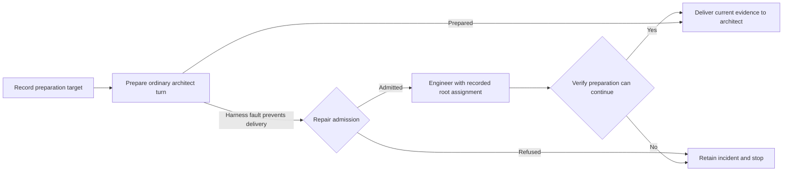

# Automatic project repair

**Date:** 2026-10-12. **Status:** Architecture hypothesis for experimentation.
The first implementation is described by the
[automatic project repair contract](automatic-project-repair.spec.md). Plan 40 is
implemented, qualified and merged into `main`; that prerequisite is met. The user
authorized this bounded experiment. Its scripted preparation obstruction does not
establish a residual production failure; real-run benefit assessment remains
tracked by `ramify-agent-18f`. Implementation tracking is `ramify-agent-6ft`.

Design history: `ramify-agent-d7i` records the completed initial analysis and
`ramify-agent-n34` the completed first draft. `ramify-agent-rvj` records this
feedback review. These are design tasks, not implementation tracking.

When a fault in the harness prevents it from delivering control to the
responsible architect, one bounded coding session might repair the target
project enough to resume that delivery. The session would use an explicitly
assigned root subtree and the existing engineer equipment. Its task would be
narrow even though its source access could span the project.

This hypothesis calls that operation **automatic repair** and its retained
evidence a **repair incident**. Existing run restoration and infrastructure
recovery retain their names, `RecoveryId`, `rec-*` identities and failure reasons.
A repair incident uses a separate `incidentId`; it does not reuse
[`recoveryId`](../../subs/harness/src/run/records.ts).

Repair would restore workflow progress. It would not establish implementation
completion, change a semantic decision or satisfy acceptance gates.

## Relationship to Plan 40

[Plan 40](../plans/40-invalid-project-recovery/main-plan.md) is implemented and
merged. Its [qualified stage-one implementation](../plans/40-invalid-project-recovery/audit-qualification.md)
at `39dfae593e836fbe98b74830c17e865550d6e7d2` provides typed provider failures, durable effective write
authority, historical admission, architect continuation and honest candidate
qualification. This hypothesis depends on those mechanisms and does not add a
second write guard. The separate
[checkpoint evaluation](../plans/40-invalid-project-recovery/checkpoint-evaluation.md)
is complete and defers adoption; checkpoints are not a dependency here.

The revision-preview rerun of 2026-10-12 is
evidence for Plan 40. Its invalid declaration and failed architect preparation
are covered by Plan 40's qualified partial-result and architect correction
behavior. That case is a negative test for unnecessary automatic repair,
not a witness justifying this additional workflow.

Plan 40's statement that it adds no agent role, submission kind or recovery
workflow describes Plan 40's scope. Any workflow introduced here would be a
separate later change building on the delivered implementation.

### Candidate obstruction requiring evidence

One possible residual case is a harness prompt assembler that assumes a source
path in a retained preparation input still exists. An allowed rename leaves a
structurally valid project, but the assembler throws an ordinary filesystem
exception before it can deliver the next architect turn. Plan 40's handling of
unavailable ownership does not, by itself, specify correction of every unrelated
filesystem assumption in harness preparation.

If restoring a compatible source entry at that path preserves the intended
behavior and the recorded module structure, a coding session could unblock the
turn. If it requires changing the running harness or violating the plan, the
session must report that it cannot repair the target.

This is a hypothetical qualification case, not an observed post–Plan 40 failure.
The original proposed adoption gate was to demonstrate a concrete instance
against qualified Plan 40 before implementation. The user subsequently authorized
a bounded implementation experiment, qualified with an injected source-dependent
preparation failure. A straightforward correction to a real prompt-assembler
defect may still remove the need for fallback. Production benefit is unproven.

## Admission preserves decision authority

The [harness principles](../harness.principles.md) return an engineer's failure
to its architect and reserve terminal failure for what the harness itself cannot
continue from. Dan's recorded decision of 2026-10-11 also puts partial results,
architect-unresolved and plan-deviation handling before new orchestration.

The proposed first boundary is an unexpected harness exception during preparation
of a local architect turn. Automatic repair is considered only when the harness
cannot deliver the ordinary correction turn even with Plan 40's retained inputs
and explicitly unavailable views. An error that can be delivered to that architect
continues through the ordinary workflow.

| Situation at this boundary | Proposed behavior |
| --- | --- |
| Unexpected harness preparation exception that prevents architect delivery | Consider the recorded repair assignment if all admission conditions hold. |
| Unavailable ownership or views handled by Plan 40 | Deliver retained evidence and continue ordinary architect correction. |
| Partial result, unresolved decision or plan-deviation request | Return it to the responsible authority through the existing workflow. |
| Exhausted engineer or correction allowance | Preserve the responsible architect's decision and existing bounds; do not convert exhaustion into repair authority. |
| Explicit environment-problem outcome | Keep the existing operator path. It is not an automatic repair trigger. |
| Test failure, rejected submission, denied write or session timeout | Use existing error handling; none alone admits automatic repair. |
| Stop, terminal run, spent run budget, unsettled writer or unusable ledger | Start no repair writer; retain available diagnostics. |

Admission requires all of the following: the unexpected failure occurred at the
supported boundary; no ordinary continuation can consume it; a durable matching
continuation target and valid repair assignment exist; the ledger is usable;
every previous writer is confirmed settled; no stop is pending; and both the
repair allowance and whole-run budget remain available. Unknown conditions do
not satisfy this predicate.

The proposed bound is one repair invocation per run, using captured engineer
time, context and command limits capped by remaining run limits. Numerical
defaults and their suitability remain part of qualification. Repair cannot
launch another repair or reset an existing allowance.

## Root assignment and structural protection

The session follows the existing subtree model in
[Every Agent Scope Is a Cut on the Module Tree](../harness.spec.md#every-agent-scope-is-a-cut-on-the-module-tree).
The integration-agent precedent permits a narrow correction across descendants
of a common ancestor. Here the chosen ancestor is the project root.

Root ownership alone does not include child implementations. While current
ownership is available, the plan architect would explicitly issue a contingent
repair assignment at the root, naming the included child trees, their reasons
and instructions, and any permitted configuration edits. The harness would
capture its effective region through Plan 40's assignment machinery before an
operation can activate it. This prior delegation is a new proposal to qualify;
the harness cannot infer it from a plan-wide read context or a later exception.

The assignment can cover the project's existing module source without individual
module handoffs. Owned nested projects still need explicit inclusion and retain
their own instructions; external trees remain excluded. Known narrowing and
protected paths are retained. New modules added by ordinary authorized work do
not silently enter an old repair assignment: inclusion requires a new valid
assignment before it can be used.

The repair session uses Plan 40's shared guard: current placement when available,
otherwise the previously recorded effective authority and retained restrictions.
A current refusal remains a refusal. Missing historical authority cannot be
replaced with a filesystem-root allowance or manufactured while the project is
invalid. This design proposes no exception to the module-scope principle.

The session may restore declaration validity, but may not create, remove or
re-parent modules or change ownership boundaries. It has no bootstrap authority.
It cannot revise accepted interface guarantees without the ordinary responsible
architect process. Structural redesign remains subject to the principle that a
person approves structural changes. Logical and physical containment, excluded
trees, generated acceptance features, frozen inputs, harness configuration and
durable records retain their existing protections.

Use ordinary engineer read, search, edit, write and tracked shell equipment with
a task-specific prompt. Shell effects retain their existing observed status;
shell execution cannot be presented as a way around a denied edit. A fresh
session works from the project root under exclusive writer ownership. It does
not edit the running harness, progress records or Git history.

## Record the continuation before preparation

The current [outer driver catch](../../subs/harness/src/run/service.ts) records a
terminal failure; it cannot reconstruct an arbitrary safe continuation from an
exception message. The supported boundary therefore needs a durable preparation
record **before** starting the fallible operation.

That record would identify the operation and owning work item, the accepted
partial result and assignment, the intended next architect task, its input
references, the applicable repair assignment, and the ledger prefix and candidate
identity on which preparation begins. If recording it fails, the operation must
not start under an assumed continuation contract.

A failure is attached to this operation identity. Only the matching unfinished
preparation can admit repair. Completion consumes the preparation once; accepted
agent submissions and already committed effects are not replayed. A generic
catch with no matching record continues to fail normally.

This proposal supports only preparation that can safely be repeated after its
inputs are refreshed. Extending it to operations with side effects requires a
separate replay contract. Process-crash repair and resurrection of terminal runs
are outside the hypothesis's first experiment.

## Repair prompt and result

The primary diagnostics are the thrown harness error, stack and operation inputs,
plus the typed provider failure evidence from Plan 40 when a provider call was
involved. [`failureDigest`](../../subs/harness/src/work/failure.ts) describes an
engineer invocation that ended without a result. It cannot represent a harness
exception after a successfully submitted partial result. Such a partial keeps its
original outcome; an engineer digest is supplementary only when independently
relevant.

The prompt supplies the captured plan and acceptance pointers, blocked operation,
active goal, original assignment and partial result, prior correction attempts,
repair authority and limits, last accepted commit and current staged, unstaged
and untracked candidate. It links complete diagnostics and relevant transcripts
rather than requiring another analyst to summarize them.

> Restore the named preparation operation so the responsible architect can
> continue. Inspect current files and preserve useful partial work. Make the
> smallest repair within the supplied root-subtree assignment that preserves the
> plan, module structure and accepted behavior. Do not change acceptance
> requirements or harness progress records. If the repair requires authority you
> do not hold or a harness code change, report the obstruction. Return your
> changes, checks, remaining work and evidence for whether preparation can resume.

The proposed result contains `ready` or `blocked`, a change summary, checks,
remaining work and a suspected cause with evidence references. Readiness is an
agent judgment until the harness verifies it. Exact wire schemas, compatibility
rules and policy defaults must be defined in an implementation specification;
this hypothesis does not present these sketches as existing protocol formats.

## Verification and handback

Before the repair writer starts, stop normal mutations, verify previous writer
settlement and retain the exact candidate. Afterward, settle the repair writer
and capture its delta separately from the partial work already present. Check
protected inputs, module structure and scope evidence, then repeat the named
preparation operation against the refreshed candidate.

Successful handback means the ordinary architect turn can be delivered again.
It does not require every test to pass or every view to become current: Plan 40
can legitimately deliver a turn with retained views and an explicit analysis
gap. Structural validity and current ownership remain mandatory wherever the
normal acceptance rules require them. If the harness cannot establish that the
repair preserved the protected structure and inputs, it cannot declare the
repair verified.

The first experiment uses a fresh responsible-architect session with the durable
work history, original partial result, repair report and current evidence.
Affected prepared assignments are invalidated, and suspended engineers need
revalidated assignments before reuse. Changed contracts or obligations return to
their responsible authorities; an incident never completes them automatically.

Subsequent gates retain the original writer's attribution and the repair
assignment's exact delta. They do not retroactively apply root authority to
earlier edits or permit later module engineers to keep writing with it. Previous
acceptance remains evidence about its original commit. Existing
[reconciliation](../../subs/harness/src/reviews/reconciliation.ts) uses audited
source and does not itself provide a handback for an unaccepted repair candidate.

Blocked, expired or unverified repair stops with both failure accounts and all
partial edits retained. The original obstruction remains visible after a
successful handback. A service interruption during repair requires manual
attention in the first experiment; restart does not imply writer settlement or
authorize another invocation.

## Repair incidents and Beads delivery

The harness would retain an incident under a distinct `(runId, incidentId)`
identity, with an export identity also naming the target project. Its lifecycle
records admission or refusal, invocation, agent result, verification and
continuation outcome. Evidence includes the preparation record, observed failure,
versions, candidate references, changes, diagnostics, time and usage. Suspected
causes remain separate from verified observations.

There is currently no Beads adapter or runtime dependency in the harness. The
proposed integration is an optional external `bd` CLI adapter, outside the agent's
tools. Service startup configuration would name an absolute `bd` executable and
an absolute existing Beads workspace directory. The service captures those
settings for export; it never infers a tracker from the target project's cwd.

The adapter invokes `bd -C <workspace> ... --json` with argument arrays through
the harness's bounded command runner. It creates a **task** labelled
`repair-incident`, with a stable external reference such as
`ramify-agent:repair:<projectKey>:<runId>:<incidentId>`. Triage can later classify
an established defect as a bug. Repair success does not close that investigation.

Before creating, query the exact external reference with `bd list --all
--external-ref <ref> --limit 0 --json`. Reuse the returned issue if unique; if
creation has an uncertain result, query again before retrying. Multiple matches
are an export conflict for operator attention. Serialize exports for an incident;
do not assume that query-then-create is an atomic uniqueness guarantee in Beads.
Store the issue ID durably before later updates.

Local incident persistence precedes export. Retain a self-contained JSON export
payload with the incident, so a target running without a ramify-agent checkout,
`bd` installation or accessible tracker still records the event. Missing
configuration or CLI failure leaves export pending and visible; it does not
block repair. An operator can later invoke the same exporter against the retained
run directory with an explicit Beads workspace. Packaging that invocation and
versioning the export payload belong to the implementation specification. No
automatic checkout creation, Beads initialization or remote sync is proposed.

Admission refusals retain their reason when the ledger is usable. If persistence
itself is broken, preserve available diagnostic output without claiming guaranteed
Beads delivery.

## UI and measurement

The web module projects harness-owned incident records in the existing Run
overview, event feed and session views. It writes no repair state.

While the agent runs, show **Automatic repair in progress**, the obstruction and
live transcript. Retain an **Automatic repairs** count and incident history after
handback or completion. Incidents refused before an invocation are shown
separately from attempted repairs. Existing run-restoration and infrastructure
recovery labels keep their current meaning.

Incident details include preparation identity, changes, verification, remaining
obstruction, time, usage and Beads task ID or pending-export status. Stop remains
available. Plan completion and repair outcome are separate, and measurements
distinguish completion with automatic repair from ordinary module-aware delivery.

## Evidence required before adoption

With Plan 40 qualified and merged, demonstrate a residual harness obstruction
with a legitimate target repair. Then define the preparation and incident schemas,
contingent root-assignment lifecycle, result contract, export format, startup
settings, budgets and backward-reading behavior before implementing the workflow.
These open contracts are why this document is an architecture hypothesis.

Qualification follows the repository's [test boundaries](../testing.spec.md):

| Case | Required evidence |
| --- | --- |
| Original invalid-declaration rerun | Plan 40 delivers ordinary architect correction without automatic repair. |
| Demonstrated residual preparation fault | The target was recorded before failure; one authorized repair restores delivery. |
| Semantic contradiction, spent correction or environment outcome | Existing authority and operator handling are preserved. |
| Root assignment unavailable or narrowed | No invented or widened historical authority; real refusals remain refusals. |
| Module creation, removal, re-parenting or ownership change | Repair cannot accept the change or silently redefine its scope. |
| Successful partial followed by harness exception | Engineer outcome remains partial; the incident carries the separate harness diagnostics. |
| Handback with unfinished implementation | Ordinary work continues without fabricated acceptance or stale assignment reuse. |
| Stop, interruption or unverified settlement | No duplicate repair or unsupported continuation. |
| No Beads installation, workspace or confirmed create result | Durable pending export and reconciled task identity, without claiming delivery. |
| Completion after repair | UI and measurements retain the incident, cost and attribution. |

Ordinary tests script Git, provider, command and Beads responses. Actual process
claims require reviewed native-test boundaries. If the residual witness does not
support a useful fallback, keep incident reporting and correct the harness fault
without adding a new implementation workflow.
